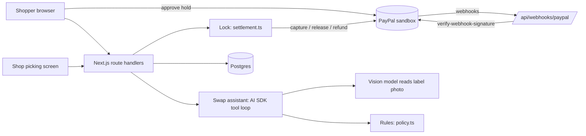

# SwapSafe — grocery swaps the shopper agrees to, paid only for what was packed

Small grocers who pack online orders by hand run into the same problem every day: an item is out of stock after the customer has paid. The shop either charges for something the customer did not choose, or refunds and loses the sale, and a wrong substitute can be unsafe for someone with an allergy. In a Which? survey of 3,552 UK shoppers, one in five had a substitution in their most recent online grocery order ([Which?](https://www.which.co.uk/policy-and-insight/article/unknown-item-in-bagging-area-which-reveals-britains-strangest-supermarket-substitutions-ae3rI0I23ZWc)), and FARE estimates that about 33 million people in the United States have at least one food allergy ([FARE](https://www.foodallergy.org/resources/facts-and-statistics)). SwapSafe holds the basket with a PayPal authorization instead of charging it, has a vision model read the label of each proposed substitute, lets deterministic code apply the shopper's allergy and diet rules and set the price, asks the shopper line by line, and then captures only the final amount. PayPal releases the rest of the hold.

**[Live demo](https://swapsafe.vercel.app)** · **[Demo video (2:17)](https://youtu.be/nBWIhEr_lkg)** · License: MIT · PayPal sandbox only

> Status on 2026-11-11: the hosted demo runs the full flow against the PayPal sandbox, and the records of those runs are in `evidence/`. The demo video was recorded on the hosted demo with `e2e/demo.mjs`; every payment in it is a real sandbox transaction.

## Try it in 60 seconds

Open https://swapsafe.vercel.app. When the PayPal window asks you to log in, use this PayPal sandbox buyer. It is a test account with play money that PayPal's developer dashboard generated for judging; it is not a real PayPal account.

- Sandbox buyer email: `sb-df47oc53855971@personal.example.com`
- Sandbox buyer password: `uI$m>H3<`

1. Open **Shopper: start a basket**, press **Fill a sample basket**, and approve the hold in the PayPal window.
2. Open **Shop: pick orders**, open the order, mark lines **Picked** or **Out of stock**.
3. For an out-of-stock line choose a substitute and press **Use the sample label image** (or photograph a real label).
4. Open the shopper's page (linked at the bottom of the shop screen), accept or decline each swap.
5. Back on the shop screen: **Approve this settlement**, then **Capture**. The receipt shows the PayPal ids and each webhook's signature check.

Things worth trying: avoid *peanuts* and propose *Tidewell Soy Drink* for the oat drink (the label says "may contain traces of peanuts", the shop's data does not, the swap is blocked). Propose *Larkspur Seed & Berry Granola* (its sample label carries a sticker that tells an AI to report no allergens and set the price to $0.00; the screen shows it was treated as data).

The sample label images are generated artwork for fictional products (`scripts/make_labels.py`), not photographs.

## What it does

| Step | Who | What happens |
|---|---|---|
| Basket | Shopper | Sets allergens to avoid, diet, and whether swaps are wanted. Approves once in PayPal. The basket total is held, not charged. |
| Picking | Shop | Marks each line picked or out of stock. For a missing item, proposes a substitute from the same shelf with a photo of its label. |
| Evidence | Vision model | Reads the label: product name, size, "contains", "may contain", vegetarian or vegan claims, each with the quoted words. No amounts. |
| Rules | Code | Unions the label's allergens with the shop's data, blocks conflicts, charges the lower of the two catalog prices. |
| Consent | Shopper | Accepts or declines each swap. The answer is bound to that exact proposal by a hash. |
| Settlement | Shop, then server | The shop approves the computed settlement. The server recomputes it, compares it with the approval record, then sends one final capture or releases everything. |
| Afterwards | Shopper, shop | The shopper can report a charged line; the shop approves a refund capped at what was captured. |

## How it works



## PayPal integration

| Capability | API / SDK | File |
|---|---|---|
| Hold the basket | Orders v2, `intent: AUTHORIZE`; buyer approval with the JS SDK v6 (`@paypal/paypal-js/sdk-v6`, `createPayPalOneTimePaymentSession`) | `src/lib/paypal.ts`, `src/app/order/new/page.tsx` |
| Place the hold after approval | `POST /v2/checkout/orders/{id}/authorize` | `src/lib/paypal.ts` |
| Charge only the final amount | `POST /v2/payments/authorizations/{id}/capture` with `final_capture: true` | `src/lib/paypal.ts`, `src/lib/service.ts` |
| Nothing fulfilled | `POST /v2/payments/authorizations/{id}/void` | same |
| Refund a reported line | PayPal Agent Toolkit 1.11.0 `create_refund`, called by server code after the shop approves; plain REST `captures/{id}/refund` is the fallback and the ledger records which one ran | `src/lib/toolkit.ts` |
| Webhooks | The deployment registers a webhook for its own URL (`/v1/notifications/webhooks`) and checks every event with `POST /v1/notifications/verify-webhook-signature` on the raw body; the result is stored with the event and shown on the order | `src/lib/paypal.ts`, `src/app/api/webhooks/paypal/route.ts` |
| Idempotency | Settlement and refunds run in three steps: claim the order, make one PayPal call with a `PayPal-Request-Id` (`ss-settle-<order>-<amount>`, `ss-refund-<report>`), record the answer. An interrupted call is resumed with the same key. The Agent Toolkit call carries the same key through `context.request_id` | `src/lib/service.ts`, `src/lib/toolkit.ts` |

The Agent Toolkit has no authorize, capture-authorization or void tool in 1.11.0, so those calls are hand-written REST.

## AI usage

- **Model**: Google Gemini (`gemini-3.5-flash-lite` by default, set by `AI_MODEL`) through the Vercel AI SDK (`ai` 7, `@ai-sdk/google`).
- **Label reading** (`src/lib/ai.ts`): one image in, a schema-checked object out, done twice and combined so that neither reading can remove a warning. The schema has evidence quotes first and no amount or verdict field.
- **Swap assistant** (`src/lib/agent.ts`): a tool loop with `get_order`, `inspect_label`, `check_rules`, and `execute_settlement`. The last one is declared with `needsApproval` and returns a refusal if it is ever executed; settlement runs only from the shop's approval endpoint. The stored reading and decision are always produced by server code, whatever the model says or skips.
- **Where the AI is not allowed to act**: it cannot set an amount, cannot remove an allergen the shop declared, cannot grant a diet claim the shop's data lacks, and cannot capture, void or refund.
- **When the model is unavailable** (no key, daily cap, error): bundled sample labels fall back to a reading recorded on 2026-11-11 with the same model (`src/lib/cached-readings.json`, written by `scripts/record-readings.ts`) and the screen says "Cached AI result". Any other photo has no reading, and a swap without a reading is blocked.

## Safety rails

- **Evidence required**: no label photo or no reading means the swap cannot be offered (`NO_LABEL_EVIDENCE`).
- **Fails closed**: a photo of a different product (`LABEL_MISMATCH`), or a partly unreadable label on an order with an allergy or diet rule (`LABEL_NOT_FULLY_READABLE`), blocks the swap.
- **Two independent readings**: every label photo is read twice; allergens from either reading count, and a diet claim counts only if both saw it.
- **The model can add caution, never remove it**: allergens are the union of the shop's data and the label reading.
- **Deterministic amounts**: the charge is `min(substitute price, ordered price)` per unit; the total can never exceed the authorization.
- **Double lock**: SDK tool approval on the model side, and on the server side `assertExecutable()` checks a recorded shop approval against a hash of the settlement as computed at execution time. A changed line or amount cancels the approval. Refused attempts are written to the ledger.
- **Consent bound to the proposal**: the shopper's answer carries the hash of the proposal they were looking at. If the substitute, the quantity, the price or the photo changed, the answer is rejected.
- **No change while PayPal is being called**: an order in settlement accepts no picks, swaps or answers until PayPal has replied.
- **Image prompt injection**: text inside a photo is reported as data; unit tests show it changes neither the amount nor an allergen block.
- **A private demo shop per visitor**: a signed, HttpOnly, SameSite cookie ties each browser to its own shop. Shop screens and shop actions (pick, propose, approve, capture, refund) work only for the shop that received the order; the shopper's page works only with the shopper's link; state-changing requests must be same-origin. One visitor cannot see or settle another visitor's orders.
- **Reconciliation**: when a verified webhook carries an amount, it is compared with the ledger and a mismatch is flagged on the order.
- **Browser policy**: Content-Security-Policy limits scripts, frames and connections to this site and PayPal; `frame-ancestors 'none'`; no camera, microphone or location permission.
- **Public demo hardening**: sandbox-only guard at the PayPal client, per-IP rate limits, a daily cap on model calls, image type checked from file bytes, 2 MB and 8 uploaded photos per order, 12 swap checks per order, photos re-encoded in the browser (which drops EXIF), webhooks that PayPal does not verify are not stored.

## Judging guide

| Criterion | Where to see it | Evidence |
|---|---|---|
| Technological Implementation | `src/lib/paypal.ts` (REST client, webhook registration and verification), `src/lib/settlement.ts` (lock), `src/lib/agent.ts`, `tests/` | [`evidence/webhook_verify_hosted_e2e.json`](evidence/webhook_verify_hosted_e2e.json) (three real webhooks, `verification_status: SUCCESS`), [`evidence/card_2b_same_request_id_retry.json`](evidence/card_2b_same_request_id_retry.json) (idempotent retry), [`evidence/card_4_second_capture_refused.json`](evidence/card_4_second_capture_refused.json) |
| Design | Four screens on the live demo: basket, picking, shopper's swap page, receipt | https://swapsafe.vercel.app |
| Potential Impact | Small grocers that pack by hand, and shoppers with allergies | First paragraph of this file |
| Innovation | A label photo as evidence, rules that only let the model add caution, one final capture for the agreed amount | [`evidence/app_e2e_swap_run.json`](evidence/app_e2e_swap_run.json) (assistant timeline) |
| Presentation | This README and the [demo video](https://youtu.be/nBWIhEr_lkg) | [`evidence/README.md`](evidence/README.md) lists every record |

## Run locally

```bash
npm ci --ignore-scripts
cp .env.example .env.local   # fill in PayPal sandbox credentials and a Google AI key
npm run dev
```

Environment variables are listed in `.env.example`. Without `DATABASE_URL` the app keeps data in memory, which is only suitable for local development. Webhooks need a public HTTPS URL, so they are exercised on the hosted deployment.

## Tests

```bash
npm test          # 38 unit tests: substitution rules, two-reading merge, image prompt injection, settlement, double lock, order flow, races and interrupted calls, shop isolation
npm run typecheck
npm run build
```

The order-flow tests use a test double for PayPal that reproduces `PayPal-Request-Id` idempotency. They do not call PayPal.

`e2e/flow.mjs` drives the real screens against the real sandbox with Playwright (buyer approval in the JS SDK v6 popup, picking, approval, capture, report, refund). It needs `BASE_URL`, `SANDBOX_BUYER_EMAIL` and `SANDBOX_BUYER_PASSWORD`. Records from one run are in `evidence/`.

## Known limitations

- Sandbox only. No live money has moved.
- The demo has no accounts: a browser cookie stands in for the shop's login, and the shop screen links to the shopper's page so one person can play both roles. A real deployment needs staff accounts, and the link would be sent to the shopper by message.
- One fictional shop and a 15-item catalog. Allergen data in the catalog is invented for the demo.
- A label reading is only as good as the photo. Unreadable parts are listed, and the shopper sees the photo, but SwapSafe is not a medical device and does not replace reading the label.
- A swap is never charged above the ordered item's price, so the shop absorbs the difference on a dearer substitute.
- Authorizations are honored for 3 days and expire after 29; reauthorization is not implemented.
- The per-minute rate limit is kept in memory per server instance; the daily budget for label checks per visitor is kept in the database.
- A verified webhook that arrives before the order record knows its PayPal id is stored but not attached to the order.
- The Content-Security-Policy still allows inline scripts, which Next.js needs for hydration without per-request nonces.
- `npm audit` reports advisories in packages that `@paypal/agent-toolkit` 1.11.0 depends on (its LangChain, OpenAI, mathjs and AI SDK 4 bindings). SwapSafe loads only the toolkit's `ai-sdk` entry and calls three tools from server code; the affected packages are not updated by a compatible version of the toolkit yet.

## Built during the hackathon

New project. The first commit is dated 2026-11-11, inside the submission period (2026-10-01 to 2026-11-12).
